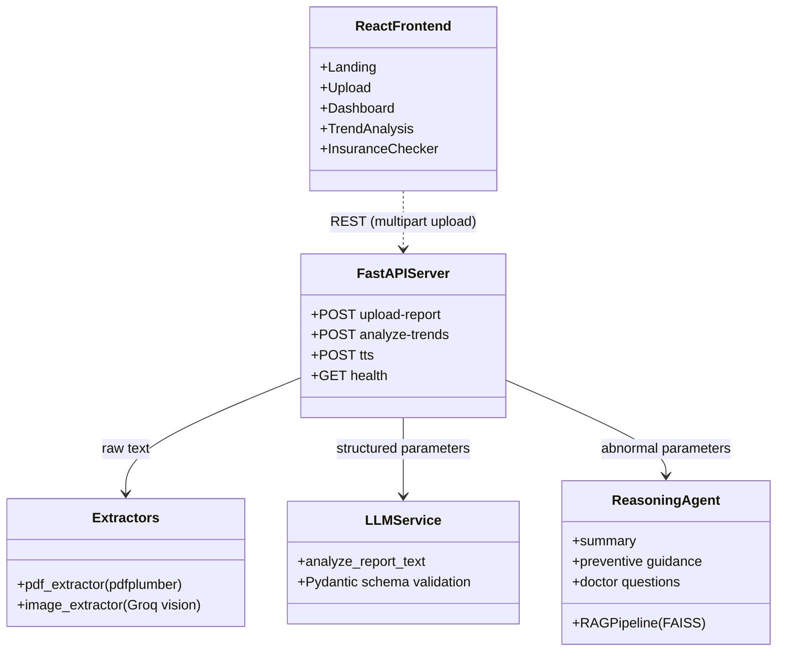
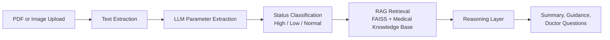

<div align="left">

# Pulse RAG — AI Health Insight Companion

**RAG-powered lab report analyzer built with FastAPI, LangChain, FAISS, React, and Vite**

[](https://python.org)
[](https://fastapi.tiangolo.com)
[](https://langchain.com)
[](https://react.dev)
[](https://vitejs.dev)
[](https://github.com/SiddarthReddyK/pulse-rag/blob/main/LICENSE)

</div>

---

## Demo

<!-- Replace with real screenshots saved in docs/ -->
<p align="center">
  
  
</p>

_Report upload and results dashboard — extracted parameters, AI summary, and doctor questions_

---

## Overview

Lab reports are full of numbers that most people can't interpret. Pulse takes a PDF or photo of a lab report, extracts every parameter, flags what is high or low, and explains the results in plain language, grounded in a medical knowledge base through retrieval-augmented generation (RAG). It also compares two reports over time to show how each value is trending.

**Domain:** Healthcare / Patient Education
**Stack:** FastAPI, LangChain, Groq (Llama), FAISS, React 18, Vite, Tailwind CSS v4
**Status:** Active Development

> **Disclaimer:** Pulse is for informational purposes only and is not a substitute for professional medical advice, diagnosis, or treatment. Always consult a qualified doctor about your results.

---

## System Architecture

A Vite-powered React client talks to a FastAPI backend over a REST API. The backend orchestrates extraction, classification, retrieval, and reasoning, with the LLM served by Groq.



---

## Analysis Pipeline

Every uploaded report goes through the same pipeline, and the trend endpoint runs it once per report before comparing them.



---

## Features

- **Multi-Format Upload** — Accepts PDF and image lab reports (JPG, PNG, TIFF, BMP, WEBP) up to 10 MB, with image text read by a Groq vision model, so no Tesseract install is needed.
- **Structured Extraction** — An LLM pulls every parameter (name, value, unit, reference range) into a validated Pydantic schema.
- **Rule-Based Classification** — Each parameter is re-classified as High, Low, or Normal against its reference range, so flags don't rely on the LLM alone.
- **RAG-Grounded Insights** — Abnormal parameters are used to retrieve context from a FAISS-indexed medical knowledge base before the LLM writes the explanation.
- **Patient-Friendly Output** — A plain-language summary, lifestyle-only preventive guidance, and 3 questions to ask your doctor.
- **Trend Analysis** — Compare an older and a newer report to get per-parameter direction, absolute change, percentage change, and a bar chart.
- **Multilingual Support & Voice** — Summaries can be generated in multiple Indian languages and played back as audio (gTTS).
- **Insurance Checker (UI prototype)** — Chat-style interface for asking coverage questions about an uploaded policy. Frontend only for now; backend integration is planned.

---

## Project Structure

```text
├── backend/
│   ├── app/
│   │   ├── main.py              # FastAPI entry point, CORS, health check
│   │   ├── router.py            # Upload, trends, and TTS endpoints
│   │   ├── schemas.py           # Pydantic request/response models
│   │   ├── llm_service.py       # LLM parameter extraction (Groq)
│   │   ├── pdf_extractor.py     # PDF text extraction
│   │   ├── image_extractor.py   # Image text extraction (vision model)
│   │   └── graph_generator.py   # Trend bar chart (Matplotlib)
│   ├── lab_report_analyzer.py   # Status classification and trend logic
│   ├── reasoning_layer.py       # RAG-grounded summary and guidance
│   ├── rag_pipeline.py          # FAISS index and retrieval
│   ├── medical_knowledge.txt    # Knowledge base for retrieval
│   └── .env.example             # Environment variable template
├── frontend/
│   └── src/
│       ├── app/pages/           # Landing, Upload, Dashboard, Trends, Insurance
│       ├── app/components/      # Navbar and shared UI components
│       └── styles/              # Tailwind and theme styles
├── requirements.txt
└── LICENSE
```

---

## Tech Stack

| Layer                | Technology                                                   |
| -------------------- | ------------------------------------------------------------ |
| Frontend             | React 18, TypeScript, Vite, Tailwind CSS v4, React Router 7  |
| UI & Charts          | Radix UI / shadcn components, Recharts, Lucide Icons, Motion |
| Backend              | FastAPI, Uvicorn, Pydantic v2                                |
| LLM                  | Groq (`llama-3.3-70b-versatile`), vision model for images    |
| RAG                  | LangChain, FAISS (`faiss-cpu`), text splitters               |
| Document Processing  | pdfplumber                                                   |
| Charts (server-side) | Matplotlib                                                   |
| Text-to-Speech       | gTTS                                                         |

---

## Getting Started

### Prerequisites

- Python 3.11+
- Node.js 18+ and npm
- A free [Groq API key](https://console.groq.com)

### Backend

```bash
# 1. Clone the repository
git clone https://github.com/SiddarthReddyK/pulse-rag.git
cd pulse-rag/backend

# 2. Create a virtual environment and install dependencies
python -m venv .venv
source .venv/bin/activate        # Windows: .venv\Scripts\activate
pip install -r requirements.txt

# 3. Configure environment
cp .env.example .env             # then add your GROQ_API_KEY

# 4. Start the API server
uvicorn app.main:app --reload
```

The API runs at [http://localhost:8000](http://localhost:8000), with interactive docs at [http://localhost:8000/docs](http://localhost:8000/docs).

### Frontend

```bash
cd frontend
npm install
npm run dev
```

Open the URL printed by Vite (usually [http://localhost:5173](http://localhost:5173)). In development, requests to `/api` and `/health` are proxied to the backend on port 8000.

### Production Build

```bash
cd frontend
npm run build
```

---

## API Reference

| Method | Endpoint                 | Description                                              |
| ------ | ------------------------ | -------------------------------------------------------- |
| POST   | `/api/v1/upload-report`  | Upload one report and get extraction plus AI insights    |
| POST   | `/api/v1/analyze-trends` | Upload an older and a newer report and get trend data    |
| POST   | `/api/v1/tts`            | Convert summary text to MP3 audio in the chosen language |
| GET    | `/health`                | Service health check                                     |

---
