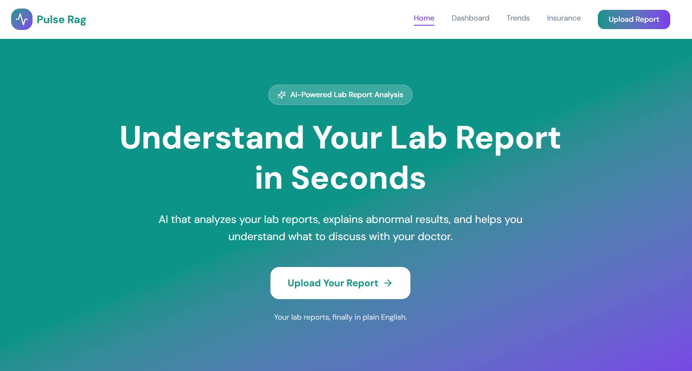
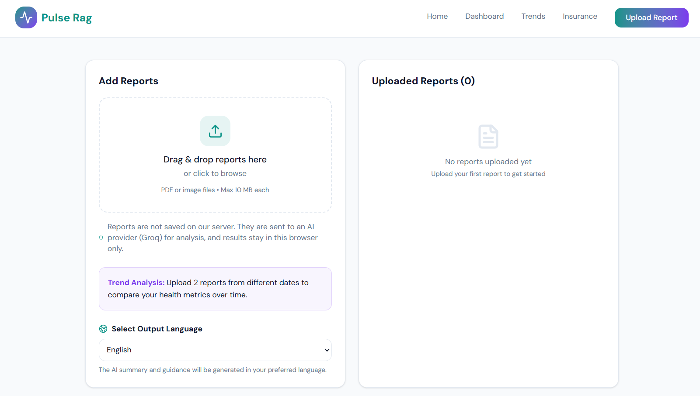
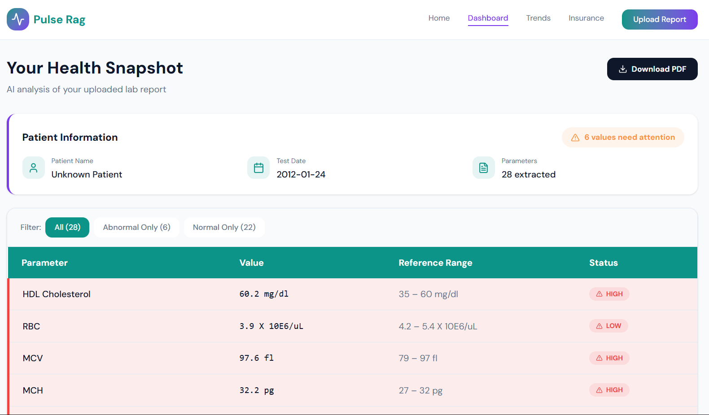
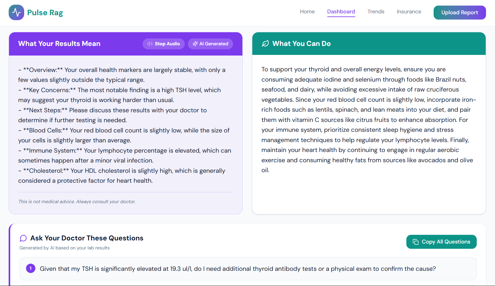
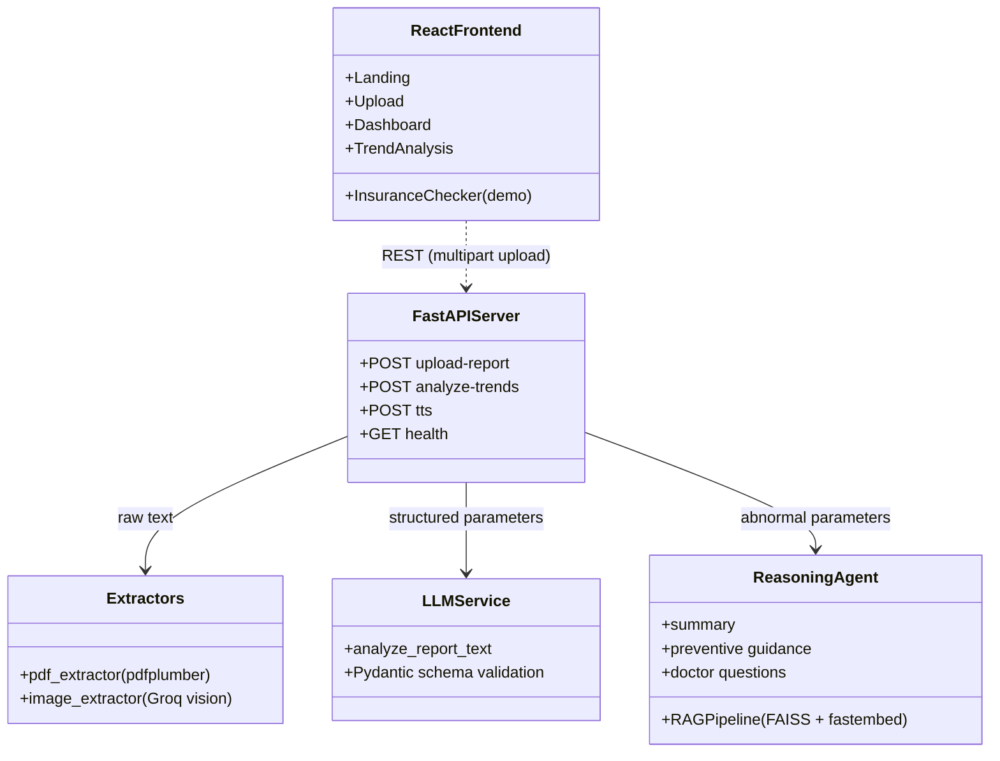
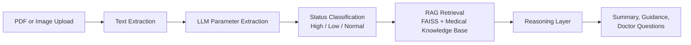

<div align="left">

# Pulse RAG — AI Health Insight Companion

**RAG-powered lab report analyzer built with FastAPI, LangChain, FAISS, and React**

[](https://github.com/SiddarthReddyK/pulse-rag/actions/workflows/ci.yml)
[](https://python.org)
[](https://fastapi.tiangolo.com)
[](https://langchain.com)
[](https://react.dev)

</div>

---

## Demo

<table>
  <tr>
    <td width="50%"></td>
    <td width="50%"></td>
  </tr>
  <tr>
    <td align="center"><sub><b>Home</b> — landing page</sub></td>
    <td align="center"><sub><b>Upload</b> — add reports and pick an output language</sub></td>
  </tr>
  <tr>
    <td width="50%"></td>
    <td width="50%"></td>
  </tr>
  <tr>
    <td align="center"><sub><b>Dashboard</b> — extracted parameters with High / Low / Normal flags</sub></td>
    <td align="center"><sub><b>Output</b> — AI summary, guidance, and questions for your doctor</sub></td>
  </tr>
</table>

---

## Overview

Lab reports are full of numbers that most people can't interpret. Pulse RAG takes a PDF or photo of a lab report, extracts every parameter, flags what is high or low, and explains the results in plain language, grounded in a medical knowledge base through retrieval-augmented generation (RAG). It can also compare two reports over time to show how each value is trending.

**Domain:** Healthcare / Patient Education
**Stack:** FastAPI, LangChain, Groq (Qwen), FAISS, fastembed, React 18, Vite, Tailwind CSS v4
**Status:** Active Development

> **Disclaimer:** Pulse RAG is for informational purposes only and is not a substitute for professional medical advice, diagnosis, or treatment. Always consult a qualified doctor about your results.

---

## System Architecture

A Vite-powered React client talks to a FastAPI backend over a REST API. The backend orchestrates extraction, classification, retrieval, and reasoning, with the LLM served by Groq.



---

## Analysis Pipeline

Every uploaded report goes through the same pipeline. The trend endpoint runs the first four steps on each report and then compares them.



---

## Features

- **Multi-Format Upload** — Accepts PDF and image lab reports (JPG, PNG, TIFF, BMP, WEBP) up to 10 MB, with image text read by a Groq vision model, so no Tesseract install is needed.
- **Structured Extraction** — An LLM pulls every parameter (name, value, unit, reference range) into a validated Pydantic schema.
- **Rule-Based Classification** — Each parameter is re-classified as High, Low, or Normal against its reference range, so flags don't rely on the LLM alone.
- **RAG-Grounded Insights** — For each abnormal parameter, relevant chunks are retrieved from a FAISS index (semantic embeddings via fastembed) before the LLM writes the explanation.
- **Patient-Friendly Output** — A plain-language summary, lifestyle-only preventive guidance, and 3 questions to ask your doctor.
- **Trend Analysis** — Compare an older and a newer report to get per-parameter direction, absolute change, percentage change, and a bar chart.
- **Multilingual Support & Voice** — Summaries can be generated in 12 Indian languages and played back as audio (gTTS).
- **Hardened API** — Uploads are validated (type, size, PDF signature), the language field is allow-listed, CORS is restricted to configured origins, and patient names are kept out of server logs.
- **Insurance Checker (demo)** — A UI prototype of a coverage assistant. Its answers are scripted sample text and are labelled as such; it does not read the uploaded policy yet.

---

## Project Structure

```text
├── assets/                          # README screenshots
│   ├── home.png
│   ├── upload.png
│   ├── dashboard.png
│   └── outputs.png
├── backend/
│   ├── app/
│   │   ├── main.py                  # FastAPI entry point, CORS, startup warm-up
│   │   ├── config.py                # Environment-based settings
│   │   ├── router.py                # Upload, trends, and TTS endpoints
│   │   ├── schemas.py               # Pydantic request/response models
│   │   ├── llm_service.py           # LLM parameter extraction (Groq)
│   │   ├── pdf_extractor.py         # PDF text extraction
│   │   ├── image_extractor.py       # Image text extraction (vision model)
│   │   ├── lab_report_analyzer.py   # Status classification and trend logic
│   │   ├── rag_pipeline.py          # Chunking, embeddings, FAISS retrieval
│   │   ├── reasoning_layer.py       # RAG-grounded summary and guidance
│   │   ├── graph_generator.py       # Trend bar chart (Matplotlib)
│   │   └── data/
│   │       └── medical_knowledge.txt    # Knowledge base for retrieval
│   ├── tests/                       # pytest suite (no network or API key needed)
│   ├── Dockerfile
│   ├── pytest.ini
│   ├── requirements.txt
│   ├── requirements-dev.txt
│   └── .env.example
├── frontend/
│   ├── src/
│   │   ├── app/pages/               # Landing, Upload, Dashboard, Trends, Insurance
│   │   ├── app/components/          # Navbar and shared UI
│   │   ├── app/config.ts            # API base URL (VITE_API_BASE_URL)
│   │   └── styles/                  # Tailwind and theme styles
│   ├── Dockerfile
│   ├── nginx.conf
│   ├── vite.config.ts
│   └── .env.example
├── .github/workflows/ci.yml         # Backend tests + frontend build
├── docker-compose.yml
└── package.json                     # Root dev script: runs backend + frontend together
```

---

## Tech Stack

| Layer               | Technology                                                      |
| ------------------- | --------------------------------------------------------------- |
| Frontend            | React 18, TypeScript, Vite, Tailwind CSS v4, React Router 7     |
| Backend             | FastAPI, Uvicorn, Pydantic v2                                   |
| LLM                 | Groq (`qwen/qwen3.8-27b`), also used as the vision model        |
| RAG                 | LangChain, FAISS (`faiss-cpu`), fastembed (`bge-small-en-v1.5`) |
| Document Processing | pdfplumber                                                      |
| Charts & Audio      | Matplotlib (trend chart), gTTS (text-to-speech)                 |
| Testing & CI        | pytest, GitHub Actions                                          |
| Deployment          | Docker, docker-compose, nginx                                   |

---

## Getting Started

### Prerequisites

- Python 3.11+
- Node.js 18+ and npm
- A free [Groq API key](https://console.groq.com)

### Backend

```bash
# 1. Clone the repository
git clone https://github.com/SiddarthReddyK/pulse-rag.git
cd pulse-rag/backend

# 2. Create a virtual environment and install dependencies
python -m venv .venv
source .venv/bin/activate        # Windows: .venv\Scripts\activate
pip install -r requirements.txt

# 3. Configure environment
cp .env.example .env             # then add your GROQ_API_KEY

# 4. Start the API server
uvicorn app.main:app --reload
```

The API runs at [http://localhost:8000](http://localhost:8000), with interactive docs at [http://localhost:8000/docs](http://localhost:8000/docs). On first start, fastembed downloads a small embedding model, so an internet connection is needed once.

### Frontend

```bash
cd frontend
npm install
npm run dev
```

Open [http://localhost:5173](http://localhost:5173). In development, requests to `/api` and `/health` are proxied to the backend on port 8000. To point the app at an API on a different origin, copy `frontend/.env.example` to `frontend/.env` and set `VITE_API_BASE_URL` (and add that frontend origin to `ALLOWED_ORIGINS` in the backend `.env`).

### Run Both Together

After the backend setup above, install the frontend dependencies once, then start both servers from the project root:

```bash
npm install                      # installs the root dev helper (concurrently)
npm run dev                      # starts the backend and the frontend together
```

The backend command uses `python` from your active environment, so activate the backend virtual environment first.

### Running with Docker

```bash
cp backend/.env.example backend/.env     # add your GROQ_API_KEY
docker compose up --build
```

Open [http://localhost:8080](http://localhost:8080). nginx serves the built frontend and proxies `/api` to the backend, and the embedding model is cached in a named volume so it is only downloaded once.

### Running the Tests

```bash
cd backend
pip install -r requirements-dev.txt
pytest
```

The tests mock the LLM and use an offline embedding fallback (`EMBEDDING_PROVIDER=hashing`), so they need no API key or network access.

### Production Build (frontend)

```bash
cd frontend
npm run build
```

---

## Configuration

All backend settings are environment variables (see [`backend/.env.example`](backend/.env.example)).

| Variable             | Default                                       | Purpose                                       |
| -------------------- | --------------------------------------------- | --------------------------------------------- |
| `GROQ_API_KEY`       | —                                             | Required. Groq API key                        |
| `ALLOWED_ORIGINS`    | `http://localhost:5173,http://127.0.0.1:5173` | Origins allowed by CORS                       |
| `MAX_FILE_SIZE_MB`   | `10`                                          | Maximum upload size                           |
| `LLM_MODEL`          | `qwen/qwen3.8-27b`                            | Chat model for extraction and insights        |
| `VISION_MODEL`       | `qwen/qwen3.8-27b`                            | Vision model for image reports                |
| `EMBEDDING_PROVIDER` | `fastembed`                                   | `fastembed` (semantic) or `hashing` (offline) |

---

## API Reference

| Method | Endpoint                 | Description                                              |
| ------ | ------------------------ | -------------------------------------------------------- |
| POST   | `/api/v1/upload-report`  | Upload one report and get extraction plus AI insights    |
| POST   | `/api/v1/analyze-trends` | Upload an older and a newer report and get trend data    |
| POST   | `/api/v1/tts`            | Convert summary text to MP3 audio in the chosen language |
| GET    | `/health`                | Service health check                                     |

---

## Privacy

- Uploaded reports are processed in memory and are not saved on the server.
- The full report text is sent to Groq's API for extraction. The insight-generation step does not receive the patient name, and names are not written to server logs. Review [Groq's data policy](https://groq.com/privacy-policy/) before using real medical data.
- Analysis results are kept in your browser's local storage so the dashboard can display them. Clear site data to remove them.
